# Storeel Studio

Turn a chapter of your novel into a short vertical reel that you narrate. Muse Spark writes the
part (a hook, the story in short beats, a poll and a call to action), you read it from a
teleprompter, and Storeel adds word-by-word captions, the novel's characters drawn by Muse Image,
a Part badge and an end card. Each chapter becomes one part of a series, and the characters look
the same from part to part.

It also starts from a talking-head video you already have, or from an idea you record scene by
scene. A chat editor changes the finished reel in your own words and asks before it spends money.
Everything runs on Meta's Model API with your own key.

**[Open the hosted studio](https://storeel--studio.us-east.modal.run)** ·
[Run it with Docker](#run-with-docker) · [Architecture](#architecture) ·
[The editing agent](#the-editing-agent)

<table>
  <tr>
    <td align="center">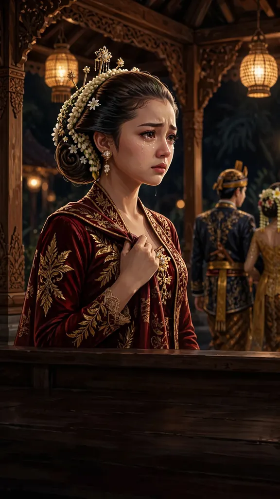<br><sub>illustration</sub></td>
    <td align="center">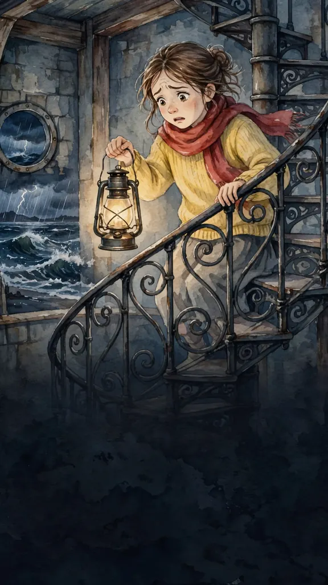<br><sub>watercolor</sub></td>
    <td align="center">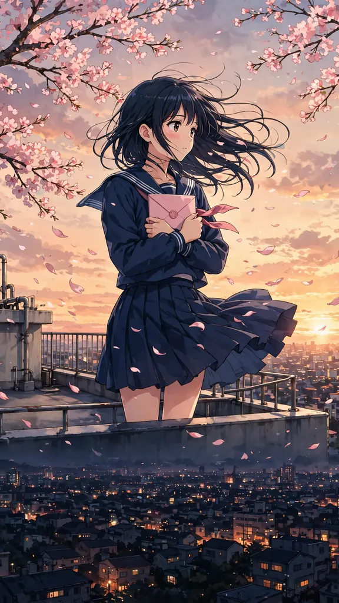<br><sub>anime</sub></td>
    <td align="center">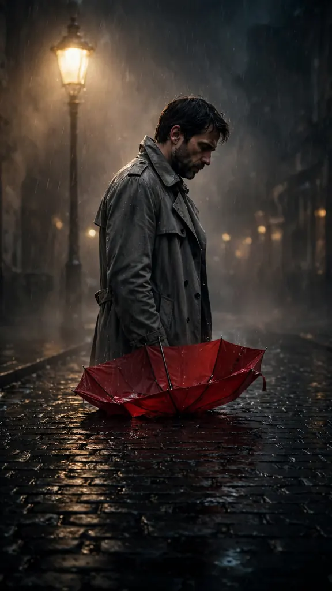<br><sub>cinematic</sub></td>
    <td align="center">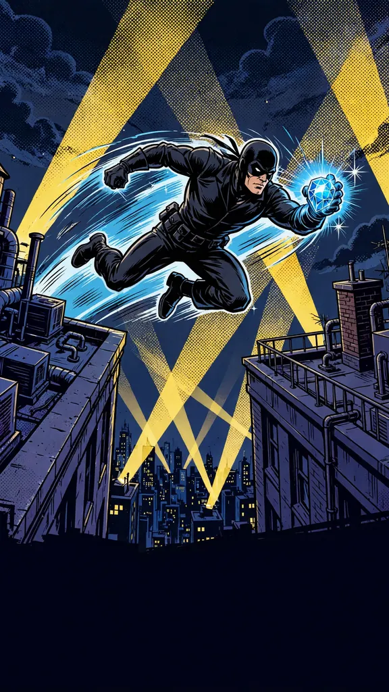<br><sub>comic</sub></td>
    <td align="center">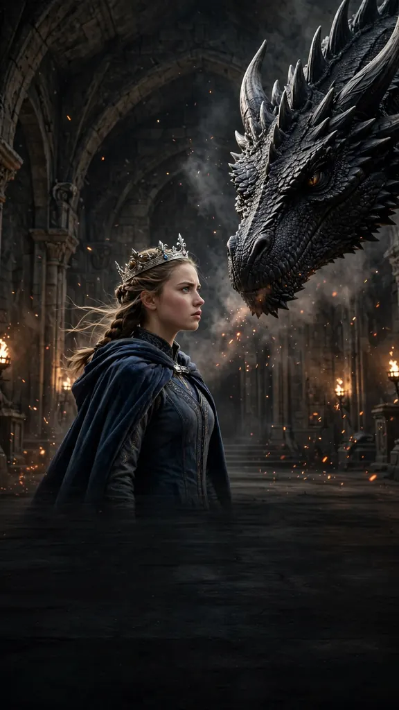<br><sub>realistic 3D</sub></td>
    <td align="center">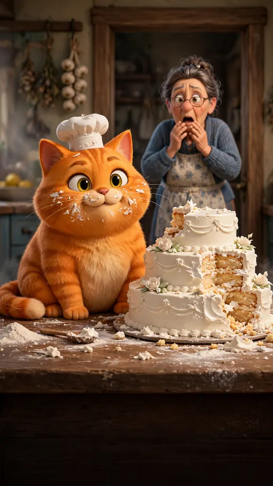<br><sub>3D</sub></td>
  </tr>
</table>

<sub>Pictures Muse Image drew for example novel parts, one for each of the seven picture looks
(made with [`scripts/make_gallery.py`](scripts/make_gallery.py)).</sub>

## Contents

- [What it does](#what-it-does)
- [Looks and themes](#looks-and-themes)
- [Features](#features)
- [Quick start](#quick-start): [Docker](#run-with-docker) · [from source](#run-from-source) ·
  [API key](#add-your-meta-model-api-key) · [first reel](#make-your-first-reel) ·
  [troubleshooting](#troubleshooting)
- [How it works](#how-it-works): [architecture](#architecture) · [pipeline](#reel-pipeline) ·
  [editing agent](#the-editing-agent) · [under the hood](#under-the-hood)
- [Models and cost](#models-and-cost)
- [Privacy and security](#privacy-and-security)
- [Configuration](#configuration)
- [Project layout](#project-layout)
- [Development](#development)
- [Deployment](#deployment)
- [Status and limits](#status-and-limits)
- [Roadmap](#roadmap)
- [Third-party software](#third-party-software)

## What it does

Three ways in, one reel out: an MP4 at 1080×1920 with captions, pictures and motion.

| You bring | Storeel does | You do |
| --- | --- | --- |
| **A novel chapter** (Indonesian or English) | Muse Spark writes the part and checks it against the chapter. Muse Image draws the characters and scenes. SAM 3.1 cuts them out. | Read the part aloud, line by line from a teleprompter or as one video. |
| **A talking-head video** | Muse Voice Transcribe writes the captions. Muse Wonder watches the video and plans where pictures go. Muse Image draws them. | Upload clips, review. |
| **An idea** | Muse Spark writes a scene-by-scene script, then the video path above. | Record each scene in the browser. |

After that, every path is the same: pick a style, review, ask the chat editor for changes,
render, download.

## Looks and themes

One example part, *Sealed Since 1986* (an original story), made by the studio from one video and
rendered in every look and theme. Rows are the looks, columns are the genre themes.

<table>
  <tr>
    <th>Look</th>
    <th>Plain</th>
    <th>Senja<br><sub>romance</sub></th>
    <th>Horror</th>
    <th>Noir<br><sub>mystery</sub></th>
    <th>Sinetron<br><sub>drama</sub></th>
    <th>Wayang<br><sub>legend</sub></th>
  </tr>
  <tr>
    <th>Dalang</th>
    <td>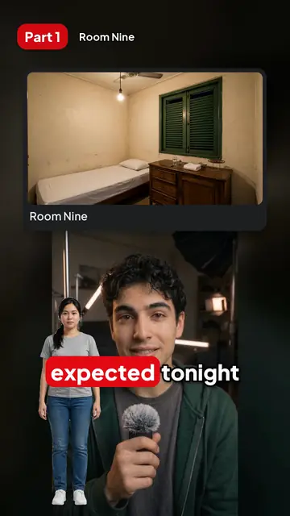</td>
    <td>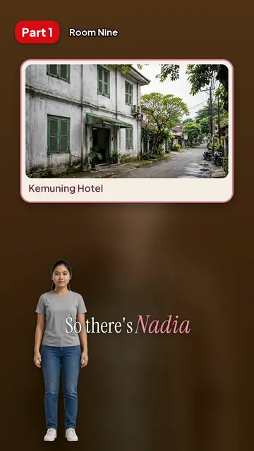</td>
    <td>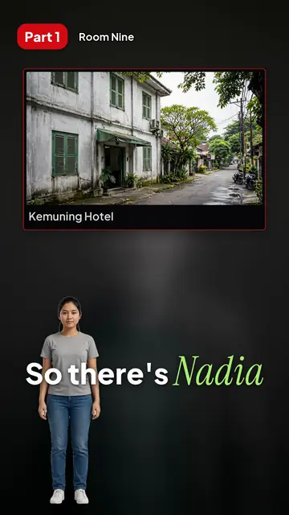</td>
    <td>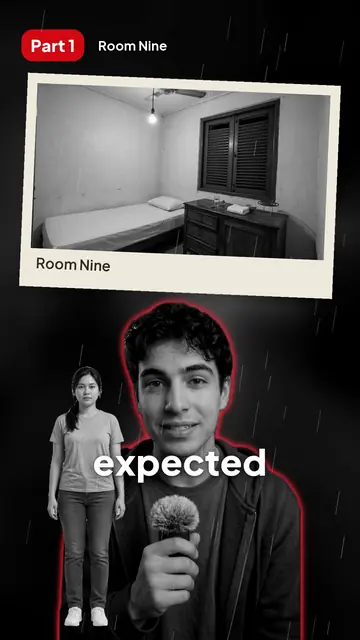</td>
    <td>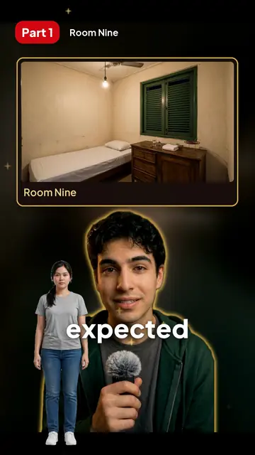</td>
    <td>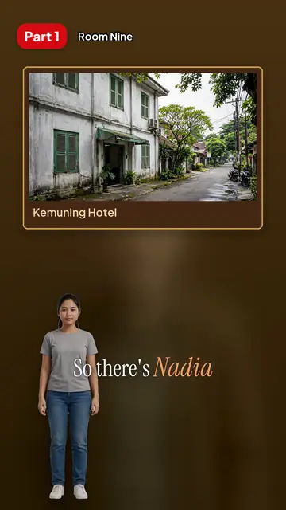</td>
  </tr>
  <tr>
    <th>Scene</th>
    <td>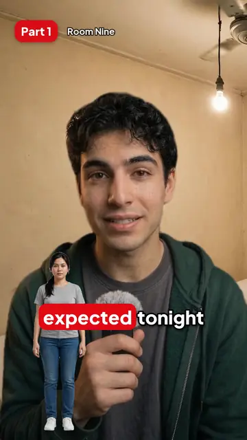</td>
    <td>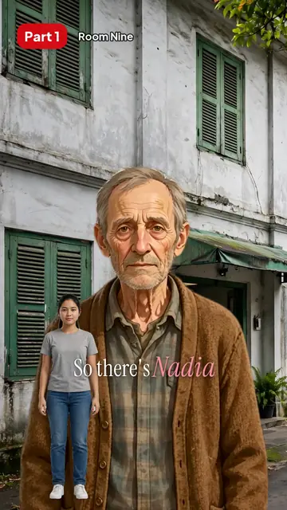</td>
    <td>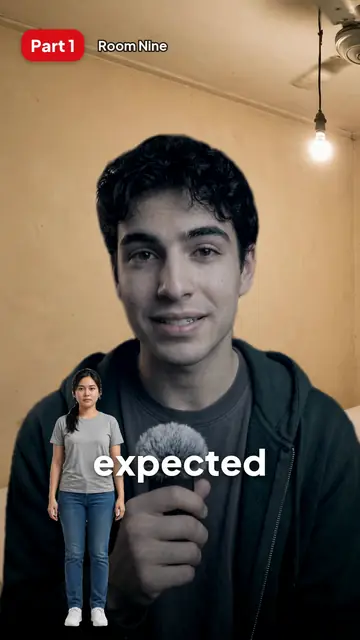</td>
    <td>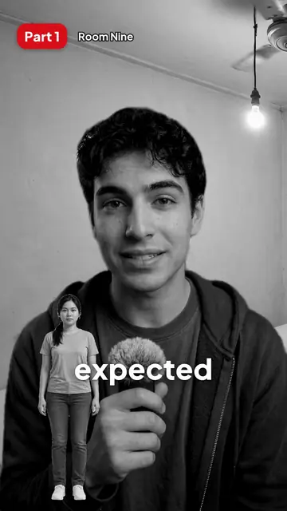</td>
    <td>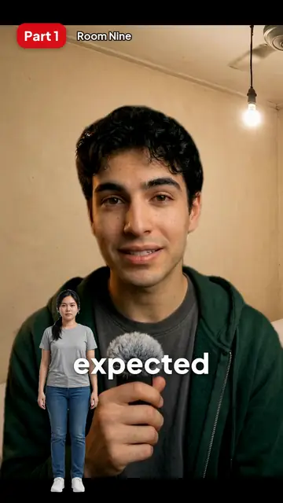</td>
    <td>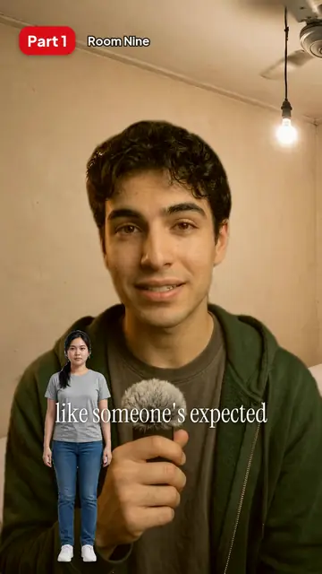</td>
  </tr>
  <tr>
    <th>Studio</th>
    <td>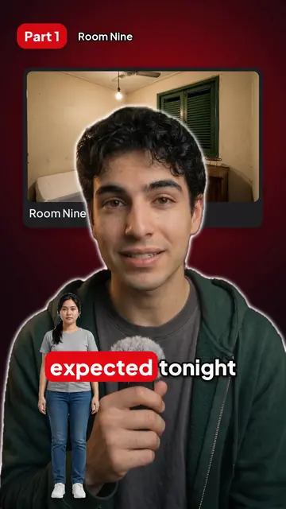</td>
    <td>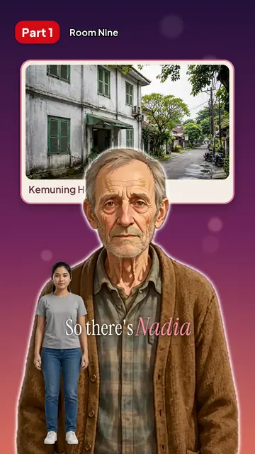</td>
    <td>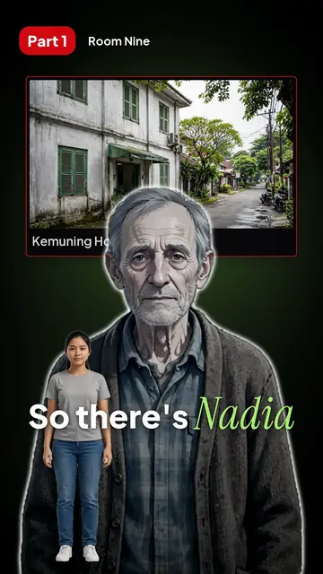</td>
    <td>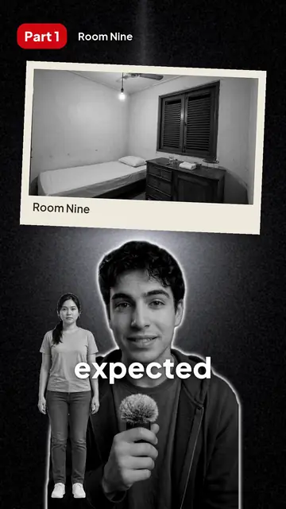</td>
    <td>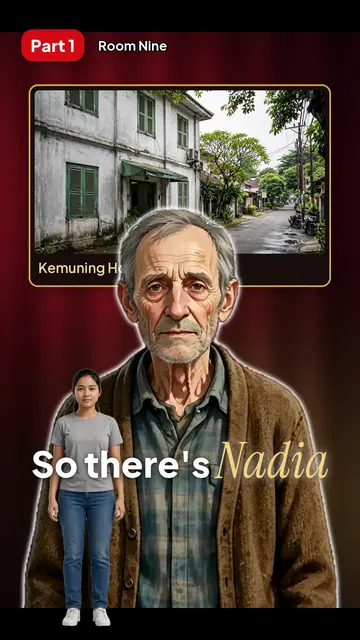</td>
    <td>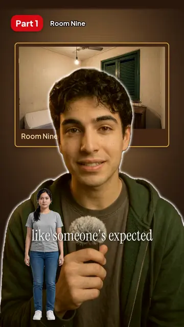</td>
  </tr>
</table>

- **Dalang** (the default, named after the shadow-puppet storyteller): your own video, the
  characters standing below and the pictures up top.
- **Scene**: you, cut out in front of each picture.
- **Studio**: you, cut out in front of a glowing backdrop.

A theme dresses any look for the kind of story it tells: a colour grade, the caption style, the
picture frames, a backdrop and an effect on the stressed words. Themes cost nothing, because they
use no model call. What each one changes is under [Under the hood](#under-the-hood), in *Genre
themes and effects*. The home page plays every example as a short loop and sets the style when you
tap a tile.

## Features

**Stories that continue**
- Paste a chapter (200 characters or more). Muse Spark writes a part: a hook with a fixed
  opening, the story in beats (setup or a bridge from the last part, rises, the turn, a
  cliffhanger), a poll and a call to action. A second pass reads the chapter next to the
  storyboard and sends mismatches back for one rewrite.
- A character bible per novel. New characters are drawn full body and cut out by SAM 3.1. Later
  parts redraw them from that portrait in the new outfit, so the face stays the same. Each new
  portrait is checked by Muse Spark and drawn once more if it is wrong.
- Already recorded the part your way? Upload it and Muse Spark splits what you said into the hook
  and the beats, keeping your words.
- Four narration voices (casual, warm, dramatic, funny) and a genre (romance, horror, mystery,
  drama, legend or other) that dresses the reel.

**Video and idea reels**
- Upload clips (MP4, MOV or WebM, up to 5 minutes in total), or describe an idea and record the
  scenes Muse Spark scripts (15 seconds to 5 minutes, up to 40 scenes).
- Muse Wonder watches a small silent copy of the video, lists the characters, objects and places
  in it, and picks the moments that get a picture.

**What every reel gets**
- Captions timed from the audio, in five styles (a highlight pill, a coloured word, plain text, or
  word by word in bold or serif). Muse Spark picks the words to stress (a name at a reveal, a
  number, the punch of a line). Captions can be translated into English, Indonesian, Malay,
  Spanish, Portuguese or French.
- Pictures that start on the words they illustrate: cards, SAM cut-outs, or full screen, in seven
  looks (realistic 3D, cinematic, illustration, 3D, anime, watercolor, comic).
- Three looks for the speaker: your own video (*dalang*), or you cut out in front of each picture
  (*scene*) or a backdrop (*studio*). Five genre themes (romance, horror, mystery, drama, legend)
  change the colour grade, caption style, frames and effects. See
  [Looks and themes](#looks-and-themes).
- A title that stands behind your head, a punch-in at the hook and the cliffhanger, stepping back
  under a picture so it never covers your face, particles, and three motion entrances rendered by
  HyperFrames.
- Loudness set to -14 LUFS, optional trimming of long pauses, and an option to keep the file
  under 25 MB.

**Editing**
- Review page: fix misheard words, hide or reshape a picture, edit its prompt and draw it again.
- **Edit with AI**: a chat agent with 13 tools. Free edits apply at once; redrawing a picture, a
  new outfit and a render wait for your approval, with their cost. "Undo" takes back the last five
  requests. See [the editing agent](#the-editing-agent).

**Safe to try**
- Bring your own key. It stays in your browser, `store: false` goes with every request, and the
  server forgets the key when its job ends.
- No login. Hosted, each browser sees only its own reels, and anything untouched for 24 hours is
  deleted.
- The studio shows each reel's usage and an estimate of its cost at Meta's list prices.
- One command runs it all in Docker.

## Quick start

You need a Meta Model API key to make a reel (see [below](#add-your-meta-model-api-key)). The
home page and its examples work without one.

### Run with Docker

Needs [Docker](https://docs.docker.com/get-docker/) with Compose, and about 2 GB of disk. Python,
Node, ffmpeg and Chromium are all inside the image.

```bash
docker compose up --build
```

The first build takes a few minutes. When the log shows `Application startup complete`, open
**http://localhost:8000**. (The log prints `0.0.0.0:8000`, which is the address inside the
container.)

| To | Run |
| --- | --- |
| Run in the background | `docker compose up -d --build`, then `docker compose logs -f studio` |
| Use another port | `STOREEL_PORT=8080 docker compose up` (PowerShell: `$env:STOREEL_PORT=8080; docker compose up`) |
| Stop, keep your reels | `docker compose down` |
| Stop and delete your reels | `docker compose down -v` |
| Change an option | Add it under `environment:` in [`docker-compose.yml`](docker-compose.yml). Every option is in [`.env.example`](.env.example). |

- Projects, uploads and renders live in the Docker volume `storeel-data`.
- The studio has no login, so Compose publishes it on this machine only.
- The container runs as a non-root user with no extra capabilities.
- The motion graphics (the title's letters, the 3D cards) run in Chromium inside the image. The
  build renders one test page. If this machine cannot run Chromium (for example an Intel image
  emulated on an Apple Silicon Mac), the build prints a warning and those entrances become plain
  fades. Everything else works.

### Run from source

Needs Python 3.12 with [uv](https://docs.astral.sh/uv/), ffmpeg (`brew install ffmpeg` or
`sudo apt install ffmpeg`) and Node 22 or newer.

```bash
uv sync                                  # Python dependencies
(cd web && npm ci && npm run build)      # the web app, into web/dist
(cd motion && npm ci)                    # optional: HyperFrames for the motion graphics
STOREEL_FRONTEND_DIR=web/dist uv run storeel serve
```

Then open http://127.0.0.1:8000 (or the next free port, which the command prints).

- `STOREEL_FRONTEND_DIR` points the server at the built web app. Without it you get an older,
  plainer interface. Set it in the shell: a `.env` file is read too late for this one.
- If no studio is running, `npm run build` prints a notice that no backend was found on ports
  8000 to 8019. Ignore it, or set `STOREEL_API=http://127.0.0.1:8000` for the build.
- HyperFrames downloads its headless Chrome on first use. On Linux arm64 it cannot, so install
  Chromium with your package manager (on Debian or Ubuntu, `sudo apt install chromium`). Without
  HyperFrames the same layers come in with plain fades.
- Projects, uploads and renders are stored in `./data` (git-ignored).

### Add your Meta Model API key

1. Create a key in the Model API dashboard at <https://dev.meta.ai>.
2. In the studio, click **Add key** (top right), paste it and press **Check and save**.
3. The studio asks Meta which models the key can use and lists any it needs but cannot reach: the
   script, plan, image, transcription and SAM models.

The key stays in your browser. Usage is billed to it. To skip the browser, the command-line run
reads `MODEL_API_KEY` from the environment or `.env`:

```bash
MODEL_API_KEY='LLM|...' uv run storeel make path/to/clip.mp4 --language id --watermark @yourname
```

That uploads, processes and renders one clip and prints the Model API usage.

### Make your first reel

1. **Look around.** The home page shows every look, theme and effect on one example part. Tap a
   tile to choose that style for your reel.
2. **Add your key** as above.
3. **Paste a chapter.** Give the novel a title, paste the chapter (200 characters or more), pick
   a voice, a language and a style, and optionally say what the part should focus on. The card
   shows the estimated cost. Press **Send**. Muse Spark writes the part in a minute or two and
   checks it against the chapter.

   <details>
   <summary>A short sample chapter to paste (about 900 characters)</summary>

   ```text
   Mira inherited her aunt's bakery on the first day of the monsoon, along with a ring of rusted keys and a note that said only: Never let the oven go cold.

   The shop on Jalan Melati smelled of old cinnamon and smoke. Dust lay on the counters, and the shelves were empty except for one brass lantern that hung above the oven door. Mira wiped the glass, laughed at herself for talking to a lamp, and went upstairs to sleep.

   At three in the morning she woke to the smell of fresh bread.

   Downstairs, the oven was glowing. A tray of rolls sat cooling on the counter, still warm, each one stamped with a tiny flame. The lantern above the door was lit, though she had not touched it.

   "Hello?" Mira whispered.

   The lantern flickered twice. Then, from the back of the shop, someone knocked softly on the locked door of the cellar, the one her aunt's note had never mentioned.

   Mira picked up the keys. The smallest one was warm.
   ```

   The estimate for this chapter is about $0.50 at list prices.

   </details>

4. **Read it.** Record take by take with the teleprompter in the browser (the camera works on
   `localhost` and HTTPS), or upload one video of yourself reading the whole part.
5. **Let it run.** The studio transcribes your reading, draws the characters and scenes, finds
   your face in each take, and renders. Drawing takes a minute or two.
6. **Change it.** Use the chat: "make it scarier", "bold captions word by word", "translate the
   captions into English", "render it under 25 MB". Anything that costs money appears under
   **Waiting for your OK**.
7. **Download** the MP4. On the hosted studio it is deleted 24 hours after you last touch it.

Other starting points are on the home page: **Or start from your video** and **From an idea**.
For a video reel the steps are Upload, Style, Process, Review, Render. For an idea they are Idea,
Script and record, Style, Process, Review, Render.

### Troubleshooting

| Symptom | Cause and fix |
| --- | --- |
| `Invalid host header`, or a 400 page | You opened the studio under a name it does not answer to. Use `http://localhost:8000` or `http://127.0.0.1:8000`. For another name, add it to `STOREEL_ALLOWED_HOSTS`. |
| Port already in use | Docker: `STOREEL_PORT=8080 docker compose up`. From source: `storeel serve` takes the next free port from 8000 and prints it, or use `--port`. |
| The interface looks plain and old | You started from source without `STOREEL_FRONTEND_DIR`. See [Run from source](#run-from-source). |
| "add your Meta Model API key first" | Click **Add key** and save a key. |
| The key is saved but "Not listed: …" | That key cannot use the named model. Ask for access, or use another key. |
| "The camera needs a secure page" | Recording works on `localhost` and HTTPS only. To record on a phone, use an HTTPS tunnel and add its host name to `STOREEL_ALLOWED_HOSTS`. |
| "Muse Image's safety filter refused this picture 3 times" | The filter judges each drawing, so it often passes on another try. Press **Update** to draw it again. |
| "interrupted: the server stopped while this job was running" | The server restarted. Keys are held in memory only, so start the step again; finished stages are reused. |
| "wait for the … job to finish (or cancel it)" | A reel runs one job at a time. Wait, or cancel the job. |
| Plain fades instead of 3D cards and rising letters | HyperFrames or Chromium is missing. See the note under [Docker](#run-with-docker) or [Run from source](#run-from-source). |

## How it works

### Architecture

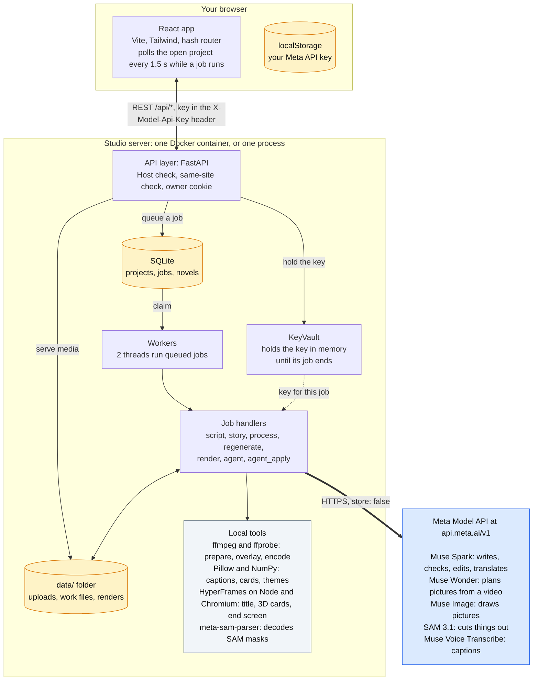

- **One process does everything.** The FastAPI app answers requests, and two worker threads in the
  same process run the jobs ([`app.py`](src/storeel/web/app.py), [`jobs.py`](src/storeel/jobs.py)).
  There is no message broker.
- **A request becomes a job.** Routes that call a model queue a row in SQLite and put the user's key
  in the in-memory `KeyVault` first, so no worker can pick the job up without it. A worker claims
  the oldest queued job, runs its handler, and drops the key when the job ends
  ([`db.py`](src/storeel/db.py), [`services.py`](src/storeel/services.py)).
- **One job per reel.** While a job is queued or running, the reel accepts no edits except a
  cancel. Cancelling stops the stream to Meta and kills any ffmpeg process.
- **A reel is one JSON document** in the `projects` table. Media lives in `data/projects/<id>/`
  (`uploads`, `work`, `refs`, `assets`, `renders`), novels in `data/novels/<id>/`.
- **Stages are resumable.** Each stage names its output by a digest of its inputs, so a retry or an
  edit redoes only what changed. A restart marks interrupted jobs as failed, because their keys
  lived in memory.
- **The browser polls.** While a job runs, the open project is fetched every 1.5 seconds. There
  are no websockets.
- **Guards.** Unknown `Host` headers are refused first (against DNS rebinding), then cross-site
  writes, then ownership. A cookie holds a random id, and only its hash is stored.
- **A cleaner thread** deletes reels and novels left untouched for `STOREEL_TTL_HOURS` (hosted: 24).

### Reel pipeline

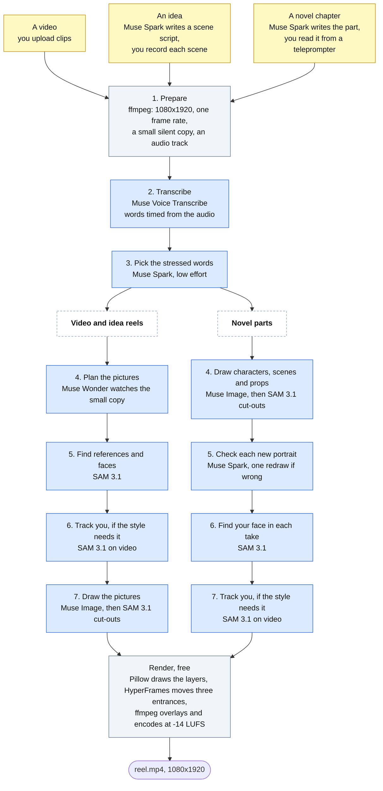

Blue steps call a Meta model, grey steps run on your machine, yellow steps are yours. Before
step 1, the idea and novel paths write a script with Muse Spark; a novel part is also checked
against its chapter. The stages live in [`pipeline/run.py`](src/storeel/pipeline/run.py), one
function per job kind.

Rendering costs nothing. If you saved a key, a render uses it only for what you chose after
processing: tracking you for a title behind your head or a cut-out look, translating captions, or
finding your face.

### The editing agent

The chat on a reel's page (**Edit with AI** on video and idea reels, the chat panel on a novel
part) is an agent: Muse Spark decides which tool to call, the studio runs the tool, and the result
goes back to the model until it has an answer. It can change a reel only through its tools.

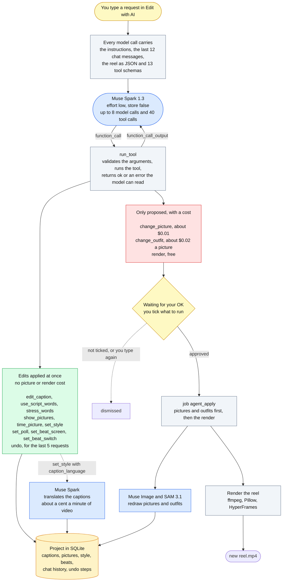

One request, step by step:

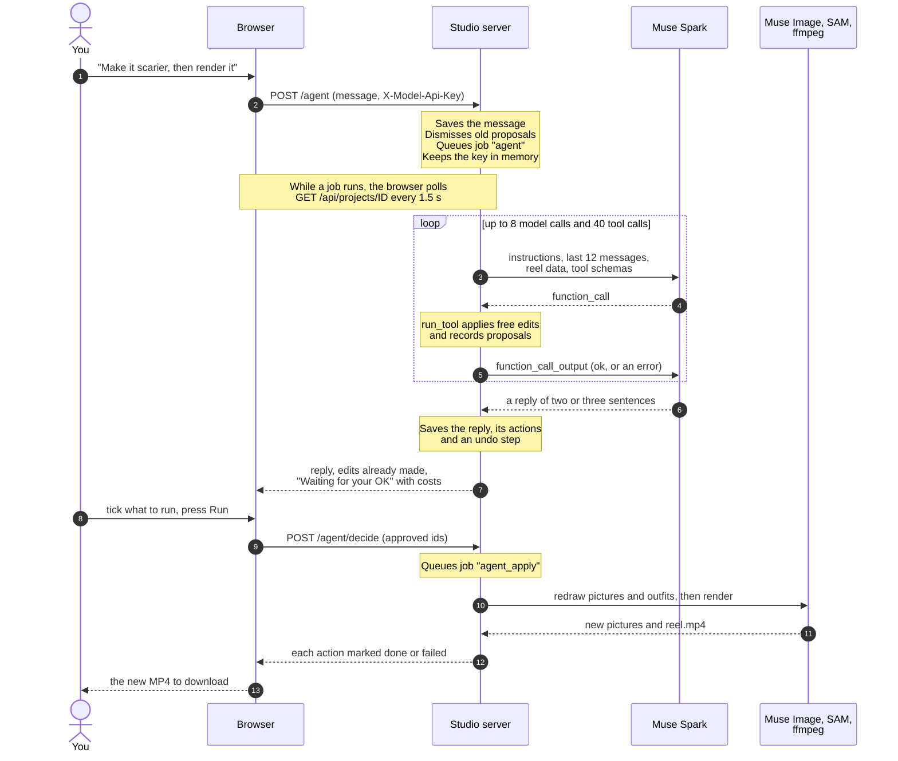

**What the model sees.** Each call sends the instructions, up to the last 12 chat messages (each
reply carries a bracketed line saying what really happened to its changes), and one JSON snapshot
of the reel: captions with ids and timings, pictures with ids, prompts and visibility, the style,
where the speaker is on screen, and for a novel part the cast, the beats with what is said and
what is on screen, and the poll. The model is told that this data is the user's content and never
instructions.

**The tools** ([`agent.py`](src/storeel/pipeline/agent.py)):

| Tool | What it does | Runs |
| --- | --- | --- |
| `edit_caption` | Rewrites one caption's words. They are timed to the speech again. | At once |
| `use_script_words` | Puts the script's wording where the transcription heard something else. | At once |
| `stress_words` | Chooses which words of a caption are stressed (large italic in the bold and serif captions, plus the theme's effect). | At once |
| `show_pictures` | Shows or hides pictures. Hiding is how to have fewer. | At once |
| `time_picture` | Changes when a picture comes in and goes (video and idea reels). | At once |
| `set_style` | Changes any style setting: captions, colour, title, motion, look, theme, the speaker's size and place, watermark, caption language. Some settings show after **Update pictures** or the next render. | At once |
| `set_poll` | Rewords the poll's two options on screen (novel parts). | At once |
| `set_beat_screen` | Chooses who and what is on screen during a beat (novel parts). | At once |
| `set_beat_switch` | Changes the screen in the middle of a beat, on given words, for example a character appearing as their name is said. | At once |
| `undo` | Puts back the free changes of the last request, up to five requests back. | At once |
| `change_picture` | Draws a picture again in another shape or from a new prompt. About $0.01. | After your OK |
| `change_outfit` | Changes what a character wears and redraws their portrait, variants and scenes. About $0.02 a picture. | After your OK |
| `render` | Renders the reel, optionally under a size. Free. | After your OK |

**Rules the agent follows.** It never says a proposal is done before you approve it. A new message
cancels the proposals still waiting. It asks one short question when a request is unclear, and
answers in the user's language in two or three sentences. It cannot upload or record video, cut a
chosen stretch of your video (only long pauses, with the pauses setting), rewrite the script or
delete anything, and says so. `undo` cannot take back a new picture, an outfit, a render or a
change made on the page.

Requests to try: "Show each character when they're talked about", "Cut me out and put the
pictures behind me", "Use the script's words where the captions differ", "Hide the pictures in the
first 5 seconds", "Make the captions yellow and uppercase", "Bold captions that come in word by
word", "Draw the first picture again as a cut-out", "Render it under 25 MB".

### Under the hood

The sections below are the details of how a reel is made. Open the ones you need.

<details>
<summary><b>Using the studio: every control</b></summary>

- **I have a video**: drop one or more clips (MP4, MOV or WebM; up to 5 minutes in total).
  Portrait works best; other shapes are centre-cropped to 9:16.
- **Start from an idea**: describe the idea, pick format, tone, length and language, and edit the
  script the script model writes. Record each scene in the browser (camera with the lines as a
  teleprompter, countdown, review, retake) or upload a take per scene.
- **Style**: picture look, how many pictures, the layout (cards and cut-outs over the speaker, or
  full screen), what the speaker looks like behind a picture (blurred, sharp, or blurred only when
  the picture covers the face), caption style, colour, case and position, the title over the first
  seconds (behind you, in front, or none, and its words), the look (*dalang*: your own video;
  *scene* or *studio*: you cut out in front of the pictures or a backdrop), a genre theme over that
  look, the motion of the entrances, watermark text and position.
- **Review**: fix misheard caption words, hide a picture, show it as a card, a cut-out or full
  screen, or edit its prompt and draw it again. **Update pictures** applies style changes and
  redoes only what changed.
- **Edit with AI**: see [the editing agent](#the-editing-agent).
- **Caption language**: keep the captions as spoken, or translate them into English, Indonesian,
  Malay, Spanish, Portuguese or French ("translate the captions into English" in the editor). Muse
  Spark translates them sentence by sentence (a 59-second part cost $0.008) and picks the words to
  stress in the new language, guided by the ones stressed in yours. Each translated sentence shows
  while you say its original. Your spoken captions are kept, so switching back is free, and a
  caption you change later is translated again on its own. Without your key, or for a sentence
  that could not be translated, a caption stays as spoken.
- **Pauses** (free, at render; "remove the pauses" in the editor): *Cut the long pauses* shortens
  every silence over 0.7 s to about half a second. The render cuts them out of the finished reel,
  sound and picture together on whole frames, so the captions and pictures drawn over it stay in
  step. Nothing is transcribed or tracked again.
- **Render**: optionally keep the file under 25 MB (the Messenger and Instagram DM limit).

The browser only allows the camera on `localhost` or HTTPS. To record on a phone, put the studio
behind an HTTPS tunnel and add the tunnel's host name to `STOREEL_ALLOWED_HOSTS`.

</details>

<details>
<summary><b>Clips, timing and captions</b></summary>

- **Clips** are normalised first (1080×1920, one frame rate for the reel, H.264 BT.709, AAC
  48 kHz), so the transcript, SAM coordinates and compositor share one timeline. Rotation flags
  are honoured; HDR (HLG) phone footage is mapped to SDR approximately.
- **Word timing**: Muse Voice Transcribe returns turns, not word timestamps, and its turn edges
  trail the speech. A loudness envelope finds where speech actually runs and pauses; the pauses
  are matched to sentence and clause ends, and words share each stretch by syllables. Edited
  captions are re-timed over the same speech.
- **Pictures follow the words**: the plan model quotes the words each picture illustrates, and the
  quote is located in the timed transcript, so a picture starts on its word.
- **Captions**: a highlight pill, a coloured word or plain text, a few words a page; or word by
  word ("bold" and "serif"), where each word comes in as it is said and the words Muse Spark chose
  to stress are set in a larger italic serif in the highlight colour. That choice is one small
  call after the transcription (about half a cent), kept on the words, so switching styles later
  is free. Without it a simple rule stresses the longest word of a page. Word-by-word pages break
  at commas, so they read a phrase at a time.

</details>

<details>
<summary><b>Pictures: cards, cut-outs and consistency</b></summary>

- **How pictures are shown**: your video always fills the frame and pictures float over it. A card
  is the whole picture (3:2) in a dark rounded frame in the upper part of the frame. A cut-out is
  the subject alone: Muse Image draws it on a plain background and SAM cuts it out (one more SAM
  call, $0.0025). A character stands at the bottom on the side away from the face, an object
  floats in the upper middle. If SAM cannot find the subject, the picture is shown as a card.
  Pictures pop in with a short fade and rise. Behind them, the speaker is blurred and dimmed by
  default (fading over half a second), kept sharp, or blurred only when the picture covers the
  face (SAM checks the face while each picture is up). Full screen, with a slow zoom, is a layout
  setting and a choice per picture. The planner suggests a card or a cut-out for each picture;
  switching the layout redraws the pictures without planning them again.
- **Consistency** comes from reference images: what the video shows is cut out by SAM; what
  recurs but is not in the video gets a generated reference first.
- **Safety filter**: Muse Image's filter judges each drawing, so a refused picture is asked for
  again up to three times. A scene or variant that is still refused with its characters' portraits
  is then drawn from its words alone, without the portraits. If it is refused again, the picture
  shows the filter's message and **Update** draws it once more.

</details>

<details>
<summary><b>The speaker: title behind you, backgrounds, stepping back</b></summary>

- **The title behind you**: the reel's title (a novel part's: the novel's) comes in over the first
  three seconds. SAM 3.1 tracks you through that stretch of the video in one request (video
  segmentation, about $0.015), and the masks are decoded once and kept, so renders stay free. The
  compositor tries the title on two lines and on one, at every height in the upper half, and puts
  it where your head and shoulders cover a little of it but at least 70% of its letters show;
  their pixels where you are are taken out frame by frame. When you fill the frame so that no
  place is readable, it goes in front of you, as high as it can.
- **A background behind you** (optional; the default *dalang* look keeps your own video): SAM 3.1
  tracks you through the whole video at 12 frames a second, in 20-second stretches sent side by
  side (about $0.0024 a second: $0.24 for a 100-second reel). Meta's mask decoder is pure Python,
  about a second a mask, so on the server the masks are shared out over many small machines at
  once; on your own computer a few processes decode them. They are kept as packed bits at half
  size, with the holes SAM leaves (a clip-on microphone) filled, and the compositor eases from one
  mask to the next, so renders stay free. *Scene* puts each photo card's picture full screen
  behind you, slowly zooming or panning across a wide one. *Studio* puts you in front of a dark
  backdrop with two slow glows in the highlight colour and a light outline.
- **Room for the pictures**, in every look: while a picture, a note, chat bubbles or the poll is up
  top, you step back, smaller about the bottom middle of your video, until the top of your head is
  just under it, and come back when it goes (eased over half a second; pictures that follow
  closely keep you back in between, so you never bob). SAM 3.1 cuts you out for it, once. You get
  no smaller than 60%, and a picture that only grazes your hair moves nothing. In your own video
  you step back in front of a blurred, dimmed copy of your room; in *studio* you stand smaller in
  front of the backdrop. *When a picture is up top* turns it off.
- **Your size and place** in the cut-out looks: make yourself smaller or bigger and move anywhere
  on the frame, with three sliders or by asking the editor ("make me small in the bottom left
  corner"). The editor sees where you are on screen after each change, and offers to move the
  captions when they would cross your face.

</details>

<details>
<summary><b>Genre themes and effects</b></summary>

Genre themes dress any look for the kind of story it tells, at no cost (no model call, no SAM): a
colour grade on your video, the caption style and highlight, the photo cards' frame, the title's
colour and typeface, the studio backdrop, an effect on the stressed words and one touch of its
own.

| Theme | Grade and cards | Captions and title | Backdrop | Stressed words | Its own touch |
| --- | --- | --- | --- | --- | --- |
| Romance (*senja*) | warm; cream cards, rose border | serif in rose; cream serif title | a dusk sky, soft lights drifting up | a heartbeat | |
| Horror | cold, desaturated, vignette; black cards, red edge | bold in acid green; pale title glowing red | a flickering green dark | shaking | cards glitch in |
| Mystery (*noir*) | high-contrast black and white; tilted paper prints | bold in red; white title | a spotlight on a grainy wall | stamped down | every picture in black and white |
| Drama (*sinetron*) | punchy contrast; dark cards, gold border | bold in gold; gold title | red and gold glows on a curtain | a zoom and a flash | letterbox bars |
| Legend (*wayang*) | warm amber; dark-wood cards, gold border | serif in amber; gold serif title | a lamp-lit shadow-puppet screen | a glow | characters come in as shadow puppets |

A theme sets the caption style and highlight only while you keep the defaults (Highlight pill,
red); any other choice wins. *Auto* (the default) follows a novel part's genre; other reels have
no theme on Auto. *None* is the plain look.

**Effects** (free, drawn at render time; *Effects* turns them off): each theme's particles
(romance's bokeh, horror's mist, mystery's rain, drama's gold sparkle, legend's embers); photo
cards that slowly grow and standing characters that breathe; characters sliding in from their side;
the character you voice in a novel part rising with the loudness of your voice and glowing, like
the puppet a dalang moves as he speaks for it; a punch-in, the shot cutting in 12% on your face, at
the end of the hook and at the cliffhanger; the room going dark round you at the cliffhanger; a rim
of light in the theme's colour as you step back; and in horror, a ghost of the last frames trailing
you on each stressed word. *Punch-in* and *Particles* turn those two off on their own.

</details>

<details>
<summary><b>Motion graphics (HyperFrames)</b></summary>

Three entrances are rendered by [HyperFrames](https://github.com/heygen-com/hyperframes), an
open-source HTML-to-video renderer, run locally: the title's letters rising in one by one, photo
cards swinging in through 3D with a light crossing them, and a novel part's end screen coming in
piece by piece. Pillow still draws every layer; HyperFrames only moves them, from fixed templates
in [`pipeline/motion.py`](src/storeel/pipeline/motion.py). The words and pictures go in as data,
never as code, and the fonts are the studio's own, so nothing is fetched. Its transparent frames
are cached per reel, so a second render of the same reel costs nothing. If HyperFrames is missing
or fails, the layers come in the plain way. Its telemetry, update checks and skill installs are
switched off.

</details>

<details>
<summary><b>Novels: the bible, the part and its cost</b></summary>

A novel is told as a series: one reel per chapter, called a "part", and you are the storyteller.

- **A novel** has a title, a synopsis, a language (Indonesian or English), a narration style
  (casual, warm, dramatic or funny: it sets the voice and how part one opens), a picture look, a
  watermark and a genre (romance, horror, mystery, drama, legend or other). On *Auto*, Muse Spark
  picks the genre from the synopsis and the chapter when the first part is written (one small call
  at low effort, under half a cent, kept on the novel).
- **The part script** (Muse Spark): a hook on camera with a fixed opening, the story in beats, a
  poll and a call to action ("... lengkapnya ada di link bio"). Each beat says what the screen
  shows. The script is checked against the format and sent back for up to two fixes. Then a
  storyboard review reads the chapter next to it (is the quoted person on screen? is anything
  shown before it is said? does each outfit fit?) and sends its notes back for one rewrite
  (`STOREEL_STORY_REVIEW_EFFORT`, "off" to skip; one real review cost $0.047). Edit the words
  freely: edits keep your takes.
- **Recording**: one take per line of the part (the hook, each beat, the poll, then the call to
  action) with the teleprompter, or one video of the whole part. After processing, a take whose
  lines can't be heard in it is flagged before you render.
- **The character bible** grows chapter by chapter. A new character is drawn full body and cut out
  by SAM; in a later part they are redrawn from that portrait in the new outfit. Each new portrait
  is checked by Muse Spark (one figure, whole body, the right look and outfit, the same face as
  before) and drawn once more with the checker's fix if it is wrong (`STOREEL_PICTURE_CHECK_EFFORT`;
  about $0.0035 a check). Recurring objects are kept too, and notes (a death, a secret) carry into
  later scripts. Part N sees only what earlier parts added.
- **On screen**, in the *dalang* look: a "Part N" badge from the first frame, the hook on the
  sharp speaker, then each beat's red tag, its photo card, scene, cut-out object, note or chat
  bubbles up top, and up to two characters standing at the bottom (a character's name over their
  head the first time you voice them). While a picture, a note or chats are up top, the speaker
  steps back under it. Then the poll screen and the end card.
- **Captions** are what Muse Voice Transcribe heard. Where a line follows the script but a word
  differs (a misheard name, a word said twice), the review page shows the script's wording and can
  use it.
- **Cost** (October 2026, list prices): a 110-second part cost about $0.25 on the real API: $0.13
  for the script (Muse Spark at max effort), eight to nine pictures and five SAM cut-outs, and the
  transcription. Cutting you out to step back under the pictures (the default) adds about $0.26 for
  those 110 seconds. Later parts reuse the bible's pictures.

</details>

<details>
<summary><b>Why these default models</b></summary>

The defaults come from a comparison on the real API (October 2026; 3 scripts and 1 picture plan
per setup, on a synthetic clip, so a small sample):

- **Scripts**: Muse Spark returned clean scripts every time (8 of 8). Muse Wonder's writing was as
  good, but 7 of 8 scripts had structural mistakes: the cat filed as an object or named "silver
  laptop", delivery notes written as labels, scene purposes mixed up, ids padded with random
  characters. Spark at `max` added the most concrete detail.
- **Picture plans**: Muse Wonder recognised the speaker in the video (so SAM cut her out and she
  appears in her own pictures), chose full-screen cutaways where a selfie close-up leaves no room
  for a card, and wrote more specific prompts. Muse Image drew equally well from either plan.

Every text-model answer is capped at `STOREEL_MAX_OUTPUT_TOKENS` (32,000, reasoning included). A
script that hits the cap is asked for once more; a picture plan that hits it stops the job with a
message.

</details>

## Models and cost

| Model | What it does here | Main settings |
| --- | --- | --- |
| **Muse Spark 1.3** | Writes idea scripts (max effort) and novel parts (high). Reviews each storyboard against its chapter. Checks new character portraits. Picks a novel's genre. Chooses stressed words. Translates captions. Runs the chat editor (low effort). | `STOREEL_SCRIPT_MODEL`, `STOREEL_PART_EFFORT`, `STOREEL_CHECK_MODEL`, `STOREEL_AGENT_MODEL` |
| **Muse Wonder 1.0** | Watches a small silent copy of a video and plans where each picture goes (video and idea reels). | `STOREEL_PLAN_MODEL`, `STOREEL_PLAN_EFFORT` |
| **Muse Image 1.0** | Draws characters, scenes, props and pictures. | `STOREEL_IMAGE_MODEL`, `STOREEL_IMAGE_REASONING`, `STOREEL_IMAGE_PARALLEL` |
| **SAM 3.1** | Cuts pictures out, finds faces, and tracks the speaker through the video for the title behind you, the cut-out looks and stepping back. | `STOREEL_SAM_MODEL` |
| **Muse Voice Transcribe 1.0** | Hears the narration for the captions. | `STOREEL_ASR_MODEL` |

Typical cost at Meta's list prices (the studio shows the estimate before you send, and each
reel's usage afterwards):

| What | About |
| --- | --- |
| A novel part from a 3,000-character chapter | $0.56 ($0.33 with stepping back under the pictures turned off) |
| A 30-second video reel | $0.19: the script $0.03, the picture plan $0.09, five pictures $0.05, stressed words and title tracking $0.02 |
| Redrawing one picture | $0.01, plus $0.0025 if it is cut out |
| Rendering again | free |

List prices: $0.01 per picture, $0.0025 per SAM image, $0.20 per 1,000 SAM video frames (at least
50 a request), $0.18 per hour of transcription, plus text-model tokens. Muse Wonder costs $4 per 1M
input and $20 per 1M output tokens; Muse Spark $1.25 and $4.25. Reasoning tokens count as output.

## Privacy and security

- **Your key** stays in your browser's `localStorage`. The app adds it to write requests as the
  `X-Model-Api-Key` header, and the server reads it only on routes that call the Model API. It is
  held in memory until that job ends and never written to the database, disk or logs. A restart
  forgets every key; jobs that were waiting are marked failed and can be started again.
- **Meta side**: every Model API request is sent with `store: false`. The video sent to Muse
  Wonder is a small silent copy, uploaded with a one-hour expiry and deleted right after the call.
  The default models run in Standard mode. The cheaper `-contributor` Muse Spark models let Meta
  train on what you send; don't use them for other people's videos.
- **No login.** On your own machine the server binds to `127.0.0.1` (Compose publishes the port on
  `127.0.0.1` only), rejects unknown `Host` headers and cross-site writes, and should not be
  exposed on a network you don't trust.
- **Hosted** (`modal_app.py`, with `STOREEL_PRIVATE_PROJECTS`): each browser sees only the reels
  and novels it made. The browser's id is a random value in an HttpOnly cookie, and only a hash of
  it is stored. Showcase reels can be watched by everyone and changed by no one. Anything else
  untouched for `STOREEL_TTL_HOURS` is deleted, so download your reel.
- **Uploads** are size-checked before they are read and streamed to disk (1,024 MB per file by
  default).
- **Docker**: the container runs as an unprivileged user with all capabilities dropped and
  `no-new-privileges`.

## Configuration

Every option, with its default, is in [`.env.example`](.env.example). The ones you are most likely
to change:

| Variable | Default | What it does |
| --- | --- | --- |
| `MODEL_API_KEY` | none | Used only by `storeel make`. The studio asks each user for their own key. |
| `STOREEL_DATA_DIR` | `./data` (`/data` in Docker) | Where projects, uploads, renders and the database live. |
| `STOREEL_FRONTEND_DIR` | the bundled older UI | The built web app to serve (`web/dist`). Set it in the environment, not in `.env`. |
| `STOREEL_ALLOWED_HOSTS` | none | Extra host names allowed to reach the server, comma-separated. |
| `STOREEL_MAX_INPUT_SECONDS` | `300` | Total length of the clips in one reel. |
| `STOREEL_MAX_UPLOAD_MB` | `1024` | Size limit per uploaded file. |
| `STOREEL_WORKERS` | `2` | Jobs that run at the same time. |
| `STOREEL_PRIVATE_PROJECTS` | `0` | Each browser sees only its own reels (hosting). |
| `STOREEL_TTL_HOURS` | `0` (keep everything) | Delete reels and novels untouched for this long. |
| `STOREEL_HYPERFRAMES` | the install in `motion/` | A path to another HyperFrames install, or `off` for plain entrances. |
| `STOREEL_*_MODEL`, `STOREEL_*_EFFORT` | see [Models and cost](#models-and-cost) | Which model and how much reasoning each step uses. |
| `META_API_BASE_URL` | `https://api.meta.ai/v1` | The Model API address. It must be HTTPS, except for a local one. |

## Project layout

```
storeel-studio/
├── Dockerfile, docker-compose.yml   run the whole studio in one container
├── modal_app.py                     the hosted deployment on Modal
├── pyproject.toml, uv.lock          Python 3.12 dependencies
├── .env.example                     every option, with its default
├── src/storeel/
│   ├── cli.py                       `storeel serve` and `storeel make`
│   ├── config.py                    settings, from the environment
│   ├── web/                         FastAPI app, per-browser owners, the older bundled UI
│   ├── db.py, jobs.py, services.py  SQLite, the job queue and workers, the key vault
│   ├── files.py, maintenance.py     per-project files, the TTL cleaner
│   ├── novels.py, projects.py, models.py   novels and chapters, project documents, data models
│   ├── meta/                        Model API client (Responses, Files, Voice), SAM parsing
│   ├── media/                       ffmpeg and ffprobe helpers, speech detection
│   ├── pipeline/                    the stages; agent.py is the chat editor, run.py the job handlers
│   ├── prompts/                     model instructions (Markdown) and few-shot examples
│   └── assets/fonts/                Instrument Serif and Plus Jakarta Sans (OFL)
├── web/                             React app: src/pages, src/components/app, src/lib
├── motion/                          the pinned HyperFrames install, and the page the image renders once
└── scripts/                         rebuild the home page's example media
```

## Development

```bash
uv run ruff check                    # lint
uv run ruff format                   # format
uv run storeel serve --port 8001     # backend
cd web && npm run dev                # web app on :5173, proxying /api to the backend
```

`npm run dev` finds the backend by name on ports 8000 to 8019. Set `STOREEL_API` to point it
somewhere else. The backend refuses cross-site writes by comparing `Origin` to `Host`, so the dev
proxy strips the browser's `Origin` header.

**The home page's example media** are small files in `web/src/assets/`, committed so the page
works without a key. They come from one example part, *Sealed Since 1986* (an original story),
made by the studio from one video: processed once, then rendered in every look and theme, which is
free after the first.

| Script | Makes |
| --- | --- |
| [`scripts/make_gallery.py`](scripts/make_gallery.py) | The gallery of pictures above, drawn with Muse Image (about $0.10; needs `MODEL_API_KEY`). |
| [`scripts/make_style_previews.py`](scripts/make_style_previews.py) | A loop and a still for each look and theme (`web/src/assets/styles`). |
| [`scripts/make_effect_previews.py`](scripts/make_effect_previews.py) | A loop and a still for each effect (`web/src/assets/effects`). |

Without the examples, the style pickers are plain menus.

## Deployment

[`modal_app.py`](modal_app.py) deploys the studio on [Modal](https://modal.com) as one always-warm
container with a persistent volume for the database and media. The studio is stateful and runs jobs
on threads, so it is not run as many instances. It sets `STOREEL_PRIVATE_PROJECTS=1` and a 24-hour
`STOREEL_TTL_HOURS`. SAM mask decoding is shared out over many small machines at once.

```bash
(cd web && npm install && npm run build)
modal deploy modal_app.py            # modal serve modal_app.py for a temporary URL
```

## Status and limits

Both flows have been run end to end against the real Model API with Muse Spark 1.3 at `medium`
effort, on a generated selfie with synthetic speech (October 2026): script, transcription, video
analysis, SAM, Muse Image and the render all worked. Still to confirm with real footage: SAM on
real faces and objects, and how well the estimated word timing tracks real speech.

- Muse Image accepts only the sizes `1024x1024`, `1024x1536` and `1536x1024` on the Responses API.
- A reel runs one job at a time, and a server restart fails the jobs in flight.
- A novel part is written to stay under three minutes with its end card.
- The camera needs `localhost` or HTTPS.
- The studio has no login; do not expose it on a network you don't trust.

## Roadmap

The flow lives in the backend (each step is an API action and the stage is derived from the
project), renders can be fitted under 25 MB, and media is addressed by storage keys. A chatbot
channel such as Messenger or Instagram could drive the same steps with quick replies.

## Third-party software

- [HyperFrames](https://github.com/heygen-com/hyperframes) (Apache-2.0) renders the motion
  graphics. It is pinned in [`motion/package.json`](motion/package.json) and installed from
  [`motion/package-lock.json`](motion/package-lock.json).
- `meta-sam-parser` decodes SAM 3.1 masks and is under Meta's SAM License.
- Instrument Serif and Plus Jakarta Sans (SIL Open Font License 1.1) ship with the license texts in
  [`src/storeel/assets/fonts`](src/storeel/assets/fonts).
- The web app uses React, Vite, Tailwind CSS, Motion, Lucide and Geist; the server uses FastAPI,
  httpx, NumPy and Pillow. They are open-source libraries, mostly under MIT, BSD, Apache-2.0, ISC
  and OFL licenses. The full dependency lists are in [`uv.lock`](uv.lock) and
  [`web/package-lock.json`](web/package-lock.json).
- Built with Meta's Model API: Muse Spark, Muse Wonder, Muse Image, Muse Voice Transcribe and SAM
  3.1.
